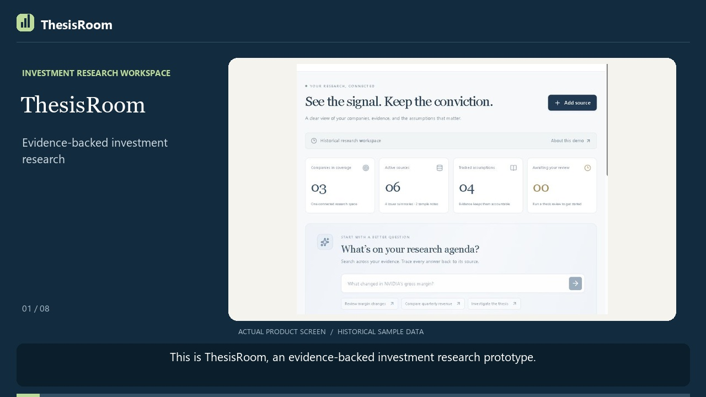

# ThesisRoom

A working investment-research prototype connecting source evidence, research answers, and human-reviewed thesis updates. Built for Swaroop's portfolio with AI assistance on the Sites/Vinext starter. Independently branded and implemented; not affiliated with Multiplier.

## Documentation

[Complete project guide](docs/PROJECT_GUIDE.md) · [Download the printable PDF](docs/ThesisRoom-Project-Guide.pdf) · [Demo walkthrough](DEMO_WALKTHROUGH.md)

The guide covers the product workflow, architecture, retrieval algorithm, source-version dependencies, Groq integration, persistence, APIs, local setup, tests, limitations, and interview questions.

To rebuild the PDF, install the optional Python dependency with `python -m pip install reportlab`, then run `python scripts/build-project-guide.py` from the repository root. Python is not required to run the app.

[](docs/thesisroom-demo.mp4)

[Watch / download the demo](docs/thesisroom-demo.mp4) · [Portable interactive version](docs/interactive-demo.html)

The interactive version is a self-contained HTML file: download it and open it in a browser. It includes the video, captions, and chapter navigation. The hosted application is currently owner-private; repository access does not grant access to that workspace.

## What works

- Coverage dashboard derived from active historical sources.
- Ranked document evidence retrieval, company/fiscal-period/as-of filtering, and source inspection.
- Typed financial comparisons that preserve units, accounting basis, and percentage-point meaning.
- Private, persistent sources, conversations, theses, proposals, evaluation runs, and activity in Cloudflare D1, keyed to the signed-in account.
- Text-based PDF extraction in the browser, plus TXT, Markdown, CSV, JSON, and pasted-text import. PDF page markers are preserved; scanned PDFs need prior OCR.
- SHA-256 deduplication, source replacement, exclusion/restoration, and stale derived-output handling.
- Analyst-checked metric entry for newly imported source documents.
- Threshold-based thesis review with explicit accept/reject decisions and traceable history.
- Sixteen deterministic in-app software checks and a separate Node regression suite.
- Live SEC submission discovery with original filing links and an explicit fallback if SEC blocks the request.
- Groq-generated research drafts with source citations, using a server-side credential; optional Anthropic support remains available. Default mode works without a model and is labelled Evidence engine.
- JSON workspace, audit, and evaluation exports.

## Stack

React / TypeScript, Vinext / Vite, Cloudflare Workers, D1 / SQLite, Drizzle migrations, PDF.js, custom evidence retrieval and deterministic financial checks. The main domain logic in `lib/core.ts` is framework-independent. Sites supplies hosted authentication; API operations require identity and use per-account storage. Updates compare revisions to prevent silent concurrent overwrites.

## Run locally

Node 22.13+ is required. From the repository root, install dependencies with `npm run install:ci`. Keep secrets out of source.

```text
npm run install:ci
```

```text
npm run build
node --import ./scripts/sites-env.mjs ./node_modules/wrangler/bin/wrangler.js d1 execute DB --local --config dist/server/wrangler.json --persist-to .wrangler/state --file drizzle/0000_bitter_black_tom.sql
npm run dev -- --port 5182
```

Open the printed loopback URL and use the local workspace sign-in. Local sign-in is a Sites development simulation and is excluded from production builds. Hosted access uses ChatGPT sign-in and the Site's private access policy.

Do not reapply the migration to a database where it already ran. Future schema changes need appended migrations.

```text
npm test
node node_modules/typescript/bin/tsc --noEmit
```

## Optional live model

The default app performs evidence retrieval, direct passage presentation, and typed comparisons without a model. Set `GROQ_API_KEY` as a hosted runtime secret and optionally `GROQ_MODEL` (default `openai/gpt-oss-120b`), then redeploy. Groq takes precedence when configured. An optional alternative is `ANTHROPIC_API_KEY` / `ANTHROPIC_MODEL`. For local preview, use an ignored `.dev.vars` file. The current default model ID is documented in `.env.example`; choose an available model for your account.

Only retrieved evidence is sent to the model. The model has no write or trade tools. Responses must contain valid source indices to be displayed as a draft; invalid outputs or provider errors fall back to the evidence engine. Citation validation checks references, not semantic truth. A live Groq-generated answer with clickable citations was exercised in the private hosted app on October 21, 2026; this smoke check is not a model-accuracy evaluation. Provider errors, timeouts, truncated answers, and missing or invalid citation indices preserve the evidence answer and display a provider-unavailable label. The configured-provider badge indicates configuration, not service health.

## Data provenance

The initial corpus has four concise factual summaries linked to NVIDIA Q4 FY2025 and Q1 FY2026, Microsoft Q3 FY2025, and AMD Q1 2025 issuer releases. These are dated historical results, not the latest market information. Two notes, all threshold assumptions, and the fictional Northstar context are synthetic demonstrations. No real fund data is included.

User-entered metrics require an explicit verification checkbox and must occur numerically in the imported text. This does not independently establish financial accuracy. Synthetic sources cannot drive numeric thesis checks.

## Demonstration and limits

See [DEMO_WALKTHROUGH.md](DEMO_WALKTHROUGH.md) for the presentation sequence and the precise limitations. The product is a portfolio prototype, not a reproduction of Multiplier's private code or an enterprise-security certification.

The public snapshot omits the owner's hosted project identifier and all runtime state. `.openai/hosting.json` retains the D1 binding for local development. To publish your own hosted copy through Sites, register a new project and use its returned identifier; the original private workspace and its secrets are not part of this repository.

## Implementation map

- `lib/core.ts`: retrieval, numerical comparisons, source versions, and thesis review rules.
- `lib/providers.ts`: server-side Groq/Anthropic requests, citation format validation, and fallback behavior.
- `lib/store.ts`: per-user D1 persistence with revision checks.
- `app/api/`: authenticated workspace, research actions, and SEC discovery endpoints.
- `tests/`: deterministic core and provider-adapter regression tests.

## Development provenance

This project was developed with substantial AI assistance. It includes retained UI components and tooling from the Sites/Vinext starter, vendored code with its license notices, and PDF.js. The source is provided so the implementation and its limitations can be inspected directly. No trained proprietary model, licensed market-data feed, or enterprise-security certification is claimed.
