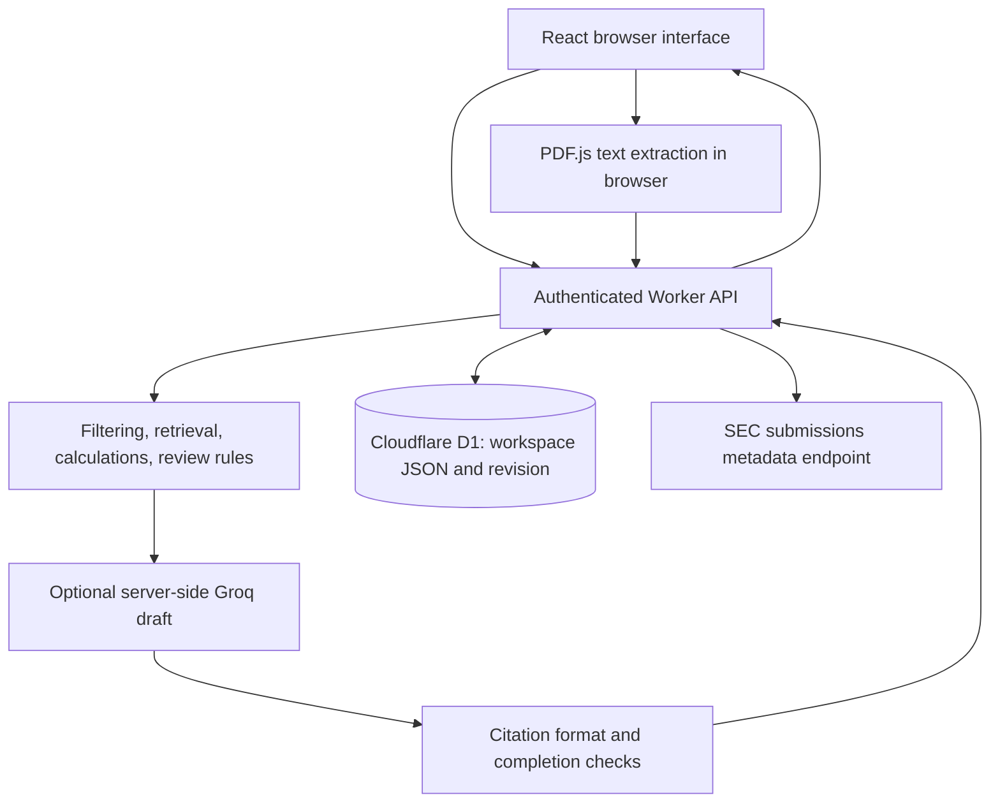

# ThesisRoom: Project Guide

Product, architecture, implementation, setup, and interview reference.

Documentation date: October 21, 2026. Code reviewed against commit `69d333af6b4ca15ed3132dbb4764ad47aaae1832`. Documentation updates do not imply changes to application behavior.

Repository: https://github.com/swaroopv4/thesisroom

## Contents

1. [Project at a glance](#1-project-at-a-glance)
2. [The problem and intended user](#2-the-problem-and-intended-user)
3. [A complete product walkthrough](#3-a-complete-product-walkthrough)
4. [Architecture and technology choices](#4-architecture-and-technology-choices)
5. [Repository and domain model](#5-repository-and-domain-model)
6. [How retrieval actually works](#6-how-retrieval-actually-works)
7. [Financial comparisons and thesis review](#7-financial-comparisons-and-thesis-review)
8. [Source lifecycle and stale answers](#8-source-lifecycle-and-stale-answers)
9. [Groq integration and model boundaries](#9-groq-integration-and-model-boundaries)
10. [Persistence, identity, and concurrency](#10-persistence-identity-and-concurrency)
11. [API reference](#11-api-reference)
12. [Local setup and configuration](#12-local-setup-and-configuration)
13. [Limits and troubleshooting](#13-limits-and-troubleshooting)
14. [Testing and verification evidence](#14-testing-and-verification-evidence)
15. [Design tradeoffs and remaining work](#15-design-tradeoffs-and-remaining-work)
16. [Presenting and explaining the project](#16-presenting-and-explaining-the-project)
17. [Code references and glossary](#17-code-references-and-glossary)

## 1. Project at a glance

ThesisRoom is a working investment-research prototype. It connects source documents, evidence-backed answers, analyst-defined assumptions, proposed thesis updates, and a record of user decisions.

The central engineering idea is dependency tracking: an answer records which source versions supported it. When a supporting source is excluded, superseded, or restored at a newer version, that answer needs a fresh research run. The application withholds stale answer content from the normal workspace response.

| Question | Current answer |
| --- | --- |
| Who is it for? | An analyst evaluating company disclosures and research assumptions. |
| What is the main workflow? | Add evidence, ask a question, inspect sources, review a proposed update. |
| Does it call a real model? | Yes. Groq is configured in the owner's private hosted app and live generation was exercised. |
| Does it work without a model? | Yes. Ranked source excerpts and typed comparisons form the Evidence engine. |
| Is it production-ready? | No. It is a bounded portfolio prototype with documented gaps. |
| Is it a Multiplier implementation? | No. It is independently implemented and is not affiliated with Multiplier. |
| Can anyone open the hosted app? | The hosted workspace is owner-private. The GitHub repository and demo are public. |

The project was developed with substantial AI assistance on the Sites/Vinext starter. Its code, retained tooling, third-party license notices, tests, and limitations are available for inspection. A trained proprietary model or access to Multiplier's private implementation is not part of the project.

## 2. The problem and intended user

Investment research can depend on documents published at different dates, numbers reported under different accounting bases, and analyst assumptions that need revision. An answer can look convincing while using the wrong reporting period, mixing GAAP and non-GAAP figures, or continuing to rely on evidence that was replaced.

ThesisRoom explores three practical questions:

- Can the analyst inspect the evidence behind a generated answer?
- Can numerical comparisons preserve period, units, and accounting basis?
- Can a change to supporting evidence make dependent research visibly stale?

The initial dataset is a historical demonstration, not a current market-data service. It contains four curated issuer summaries: NVIDIA Q4 FY2025, NVIDIA Q1 FY2026, Microsoft Q3 FY2025, and AMD Q1 2025. It also contains two explicitly synthetic notes and four sample thesis assumptions. The summaries link to original disclosures; they are not the complete filings.

The useful product claim is narrow: the application implements an inspectable evidence-to-review workflow. The repository does not establish better investment returns, universal factual correctness, customer adoption, or superiority to another company's stack.

## 3. A complete product walkthrough

### Overview

The overview derives company coverage, active-source counts, assumption counts, and pending-review counts from workspace state. Revenue values are reported historical metrics, not live stock prices. Suggested questions open the research workflow.

### Source library and import

Add a selectable-text PDF, TXT, Markdown, CSV, JSON file, or pasted text. The browser extracts text from a PDF using PDF.js and inserts page markers. The app stores the extracted text, not the original PDF binary. CSV and JSON are treated as text; there is no specialized spreadsheet or financial-table parser.

Supply a title, ticker, publication date, optional original URL, and optional reporting period. A synthetic-note checkbox distinguishes demonstration assumptions from issuer material. An optional structured metric requires the analyst to confirm verification against the text. Import computes a SHA-256 content fingerprint and rejects an active duplicate for the same company.

### Research desk

Choose a company or all companies, optionally set an evidence cutoff date, and ask a question. The server filters and ranks source passages, performs supported typed comparisons, and builds an evidence answer. If a provider is configured and evidence exists, it requests a generated draft using that evidence. The result is saved with its source-version dependencies.

An example question is: "Summarize NVIDIA Q1 FY2026 reported GAAP and non-GAAP gross margins, then separately give non-GAAP margin excluding the H20 charge."

The seeded summary distinguishes reported GAAP margin of 60.5%, reported non-GAAP margin of 61.0%, and non-GAAP margin excluding the specified charge of 71.3%. These are different measures. A model sentence still needs review even when its citation is clickable.

### Source inspector

Click a citation or source button to inspect the source's text, publication date, status, version, fingerprint, structured metrics, and original-disclosure link. The citation opens the source inspector; it does not highlight a verified exact span in the original PDF or automatically jump to a PDF page.

### Thesis tracker

An assumption defines a company, metric, threshold direction, unit, and accounting basis. Select Review new evidence to compare the latest matching non-synthetic metric with that threshold. The app creates a proposed research update; it does not rewrite the thesis automatically.

Accept updates the statement and records a decision. Reject records a rejection and leaves the statement unchanged. Accepting an update does not alter the numeric threshold or execute an investment action.

### Evaluations, activity, and exports

Evaluations runs deterministic checks on isolated fixtures. Activity lists bounded source, research, review, evaluation, and system events. Export controls download workspace, evaluation, and activity JSON. Reset demo overwrites the workspace with the seeded demonstration state; export first if its content matters.

## 4. Architecture and technology choices



| Layer | Implementation | Reason and tradeoff |
| --- | --- | --- |
| Interface | React 19, TypeScript, CSS, Lucide icons | Typed UI state and reusable controls; substantial starter UI remains in the repository. |
| Framework/build | Vinext and Vite, with Next-compatible conventions | Fits the supplied Worker-oriented starter. The runtime is Vinext, not a conventional Next.js Node server. |
| Server | Cloudflare Workers | HTTP API execution integrated with hosting and identity. |
| Persistence | Cloudflare D1 / SQLite | Simple durable account-scoped state; the JSON-row design is intentionally bounded. |
| Schema | Drizzle schema and SQL migration | Defines the workspace table. Runtime workspace reads/writes use prepared D1 SQL. |
| PDF extraction | PDF.js and a local worker asset | Extracts selectable text before upload; no OCR or table reconstruction. |
| Retrieval | Framework-independent TypeScript | Inspectable scoring and filtering; lacks semantic retrieval and a persistent index. |
| Generation | Groq HTTP API | Optional evidence-conditioned drafting; requires server-side secrets and analyst review. |
| Tests | Node's built-in test runner | Fast deterministic regression checks; provider tests mock responses. |

The original hosted app has Sites-managed authentication and storage bindings. The public snapshot deliberately omits the owner's project identifier. Its hosting manifest keeps the DB binding required for local development; it does not give a cloned copy access to the hosted workspace.

## 5. Repository and domain model

### Where to read the code

| Path | Responsibility |
| --- | --- |
| `app/page.tsx` | Main client state, navigation, action requests, research conversation. |
| `app/dialogs.tsx` | Source import, source inspection, assumptions, settings, SEC discovery UI. |
| `app/panels.tsx` | Source library, thesis tracker, evaluations, activity. |
| `app/api/` | Authenticated workspace, action, and filing endpoints. |
| `lib/core.ts` | Retrieval, comparisons, source lifecycle, thesis review, in-app checks. |
| `lib/providers.ts` | Provider selection, model requests, citation handling, fallback. |
| `lib/pdf.ts` | Browser PDF text extraction. |
| `lib/store.ts` | D1 workspace initialization, bounded serialization, revision-controlled writes. |
| `lib/types.ts` / `lib/seed.ts` | Domain types and initial historical/sample data. |
| `db/schema.ts` / `drizzle/` | Table definition and migration history. |
| `tests/` | Core and provider-adapter regression tests. |
| `scripts/`, `worker/`, `components/ui/` | Retained framework, hosting, connector, and UI scaffolding. |

### Main entities

| Entity | Important fields and purpose |
| --- | --- |
| Source | ID, title, company, date, period, text, URL, active/revoked/superseded status, synthetic flag, version, fingerprint, facts, optional replaced-source ID. |
| Fact | Metric key, label, numeric value, unit, reporting period, basis, source locator. |
| Evidence | Source ID, title, excerpt, passage locator, retrieval score. |
| Message | Question/answer text, role, evidence array, source-version map, mode, timestamp, optional elapsed time and stale flag. |
| Thesis | Company, statement, metric, operator, threshold, unit, basis, status, note. |
| Proposal | Before/after text, reason, supporting source IDs and versions, assumption key, decision status, review timestamp. |
| Workspace | Sources, theses, proposals, messages, activity, evaluation runs, watchlist, version. |

A citation number refers to the position of a passage in one answer's evidence array. It is not a global document identifier. Several citation numbers can refer to passages from the same source.

## 6. How retrieval actually works

The retriever scans the current workspace text for each question. It does not use embeddings, a vector database, a trained reranker, BM25, or an asynchronous ingestion index.

### Filtering and entity recognition

Only active sources published on or before the requested cutoff are candidates. With no cutoff, the API uses a far-future date. An omitted company defaults to ALL.

The query recognizer has explicit patterns for NVIDIA, Microsoft, AMD, Tesla, Apple, Amazon, Alphabet/Google, Meta, TSMC, Palantir, and Salesforce. One recognized query company takes precedence over the selected company. Multi-company recognition constrains candidate companies. This is application scoping, not an access-control policy.

The period recognizer handles a first matching quarter/year expression such as Q1 FY2026 or Q1 2026. It does not implement arbitrary date ranges, fiscal-calendar reasoning, or comprehensive multi-period language. An explicit period can narrow a comparison down to one period, leaving no pair to compare.

Unknown-company abstention is not universal: a company absent from the recognizer may be missed. Selecting an explicit ticker is more reliable than assuming unrestricted company-name understanding.

### Passage preparation and scoring

The tokenizer lowercases text, normalizes a few terms such as "data center" and "margins", removes a fixed stop-word list, and keeps alphanumeric tokens longer than one character. Source text is split at qualifying sentence boundaries and newlines; very short chunks are omitted.

For each unique query term, a matching passage token adds 3 points and a matching title token adds 0.7 points. A margin question gives a 4-point boost to a chunk containing both "charge" and "H20". Synthetic notes receive a 4-point penalty for many ordinary financial questions, with keyword-based exceptions for thesis/framework/context requests.

Passages scoring at least 2.9 are sorted by score, then publication date. The retriever returns the top seven passages, each excerpt truncated to 850 characters. A later typed-comparison step can append supporting fact evidence, so a final answer can contain more than seven evidence items.

This design makes the demonstration inspectable and cheap. It also misses paraphrases, relies on hand-written domain rules, truncates context, and has no full financial-table interpretation. The synthetic-note penalty is a heuristic, not a guarantee that a generated answer will exclude all synthetic material.

## 7. Financial comparisons and thesis review

### Typed comparisons

Two facts are comparable only when their metric key, unit, and accounting basis match and their reporting periods differ. The code does not convert currencies or normalize USD millions into USD billions.

For ordinary numeric units, the difference is the later value minus the earlier value; a relative percent change is also shown when the earlier value is nonzero. The denominator uses the absolute earlier value. For percentage-bearing units, the output uses a percentage-point difference.

Example: the seeded NVIDIA GAAP gross margin moves from 73.0% in Q4 FY2025 to 60.5% in Q1 FY2026. The difference is -12.5 percentage points. It is not a 12.5% relative decrease. The source separately describes the H20 charge and non-GAAP measures.

The current automatic comparison logic recognizes a limited set of revenue and gross-margin question patterns. It uses the last two candidate facts after source-publication sorting. This is not a general spreadsheet calculation engine or a complete financial-period ordering system. Model text can still contradict a supplied calculation; semantic agreement is not checked after generation.

### Threshold review

`latestFact()` considers active, non-synthetic sources for the thesis company, ordered by publication date, and selects a fact matching metric, unit, and basis. Latest means publication ordering here, not a separately verified latest fiscal period.

- `gte` means the analyst expects a minimum: a value below the threshold triggers review.
- `lte` means the analyst expects a maximum: a value above the threshold triggers review.

The scan creates a proposal containing the current statement, proposed statement, source versions, metric context, and an assumption key. That key contains the metric, operator, threshold, unit, and basis and helps avoid duplicate proposals for the same supported assumption.

Review acceptance requires a pending proposal and current supporting source versions. Accept changes the thesis statement and update timestamp, marks the proposal accepted, and logs the decision. Reject marks it rejected. Editing an assumption makes its pending proposals stale. A decision does not change the threshold, independently certify the financial data, or execute a trade.

### Imported metrics

The import path supports revenue, gross margin, Azure growth, and revenue growth definitions with predefined units and bases. The analyst must tick verification, provide a finite numeric value and period, and include that numeric value in the imported text. The check is a substring check after comma removal; it does not prove the number refers to the selected metric or establish accounting accuracy.

## 8. Source lifecycle and stale answers

### Source state and fingerprints

| State | Meaning in this implementation |
| --- | --- |
| Active | Eligible for new research, subject to company/date/period filters. |
| Revoked | Excluded from new research; the source is retained in the workspace. |
| Superseded | Replaced by another source; no longer eligible for new research. |

An imported source starts at version 1. A status change increments the version, including restoration to active. Replacement validates the new import, marks the old source superseded, and inserts a new source with a new ID. Deduplication compares the SHA-256 of exact extracted text for the same company among active sources; it is not semantic near-duplicate detection. Seeded sources use curated fingerprint labels rather than newly computed import hashes.

### Dependency tracking

An answer stores a map such as `sourceVersions = { "nvda-q1": 1 }`. `isStale()` checks whether every recorded source still exists, remains active, and has the recorded version. A missing source, changed status, or version mismatch makes the dependency stale.

`sanitize()` clones state for the workspace response. For stale messages it sets a stale flag, replaces the old content with a refresh notice, and removes the returned evidence and dependency map. For stale proposals it returns stale status and replacement explanatory text. This is application-level withholding, not physical deletion of historical text from D1.

Restoring the source does not validate the old answer: restoration creates another version, so a fresh question is required. Adding a different new source without replacing or changing an existing dependency does not automatically invalidate earlier answers. Corpus-wide freshness tracking is not implemented.

### Important boundary

Exclusion is a research-selection control. Revoked content remains in the signed-in user's workspace data and source inspector. It is not a legal deletion operation, enterprise entitlement revocation, or a mechanism for recalling exported JSON. The activity log is a bounded workspace event list, not an immutable external audit ledger.

## 9. Groq integration and model boundaries

### Provider selection

The server chooses Groq when `GROQ_API_KEY` is configured; otherwise it chooses Anthropic when its key is configured; otherwise it reports Evidence engine. A configured-provider label indicates configuration, not a live health check.

The Groq default in the reviewed code is `openai/gpt-oss-120b`. The request uses a 25-second timeout, a 3,000-token completion budget, temperature 0.3, and GPT-OSS low reasoning effort with reasoning omitted from the returned response. These are snapshot settings, not a guarantee of future model availability. The Anthropic adapter exists as an alternative but was not live-tested with a real Anthropic credential in this work.

### What leaves the server

The model receives the current question, retrieved passage titles/text and citation indices, and any supported comparison text selected as a validated calculation. The entire database and conversation history are not sent. Prior messages are stored and displayed, but are not included as conversation context in the current model request.

Retrieved excerpts may include user-uploaded text. Configuring a provider therefore sends selected document content to that provider. The application does not implement a zero-retention guarantee for external inference or an automatic document-redaction pipeline.

The system prompt asks the model to use supplied evidence, treat documents as untrusted data, distinguish accounting measures, cite claims, admit insufficient evidence, and avoid investment recommendations. The adapter does not give the model write tools, browsing tools, or trading tools. Instructions are useful boundaries; they are not proof of resistance to every malicious document or misleading question.

### Output checks and fallback

The adapter requires a completed response, nonempty text no longer than 16,000 characters, at least one recognized citation, and recognized citation numbers inside the evidence array's bounds. It normalizes supported Unicode brackets and comma-grouped numeric references into clickable bracketed indices.

An HTTP failure, request exception, timeout, incomplete response, or rejected citation format keeps the original evidence answer and changes its mode to an unavailable/fallback label. The selected provider's raw error body is not stored as answer content.

These checks do not verify that every claim is cited, that a cited passage entails a claim, that all malformed citation syntax is detected, or that the model's calculations are correct. During live testing, an accounting explanation needed correction and citation-bracket formatting needed normalization. Both observations demonstrate why a successful API call is a smoke check, not an accuracy benchmark.

## 10. Persistence, identity, and concurrency

The database has one `workspaces` table with `user_id` as primary key, serialized `state`, integer `revision`, and `updated_at`. First access inserts a seeded workspace if no row exists. All normal reads and writes bind the authenticated user ID using prepared SQL.

A mutation reads a revision and updates with `WHERE user_id = ? AND revision = ?`, increasing the revision on success. Zero changed rows indicate a concurrent write. The browser includes its revision in action requests; a mismatch detected before mutation returns HTTP 409. A later compare-and-swap failure currently becomes a generic HTTP 400 error with refresh guidance. Both situations require reloading the latest state rather than silently retrying an old edit.

Persisting one JSON object makes implementation simple but rewrites the whole workspace, creates a per-user contention point, and prevents efficient relational queries over documents or proposals. The state serializer rejects workspaces larger than 1,500,000 UTF-8 bytes. There is no background job queue, cross-user collaboration model, normalized document store, or database-backed vector index.

Hosted identity comes from trusted Sites authentication headers. Application code reads those headers; it is not itself a complete OAuth server. A deployment outside that trusted hosting path needs an authentication gateway that supplies trusted identity and prevents header spoofing. Do not treat arbitrary caller-provided identity headers as authentication.

Local sign-in is a development simulation restricted by the retained tooling to local addresses and excluded from production builds. Local storage state and hosted D1 state are separate. Server-side secrets live outside tracked source; `.env.example` contains variable names and defaults only.

## 11. API reference

All routes require a signed-in identity. Examples below show request shapes, not unauthenticated public APIs. Production access is also subject to the Site's audience policy.

| Endpoint | Purpose | Main response |
| --- | --- | --- |
| `GET /api/workspace` | Read or initialize the account's workspace. | Sanitized state, revision, user display fields, configured provider. |
| `POST /api/action` | Perform one research/source/thesis/evaluation mutation. | Sanitized state, updated revision, optional action result. |
| `GET /api/filings?ticker=NVDA` | Discover recent SEC submissions for a supported company. | Company name, filing metadata, original URLs, fetch time. |

### Action envelope

Read the current revision using the workspace endpoint before sending a mutation. The revision below is illustrative and must match the actual workspace.

```json
{
  "action": "research",
  "revision": 3,
  "query": "What changed in NVIDIA gross margin?",
  "company": "NVDA",
  "asOf": "2025-05-28",
  "useModel": true
}
```

| Action | Additional input | Effect |
| --- | --- | --- |
| `research` | `query`, optional `company`, `asOf`, `useModel` | Build and save a question/answer pair. |
| `addSource` | `source` object | Validate, deduplicate, import, optionally supersede a source. |
| `sourceStatus` | `id`, `status` | Set active/revoked/superseded and increment source version. |
| `scan` | None | Generate threshold-review proposals without accepting them. |
| `review` | Proposal `id`, `decision` | Accept or reject a pending proposal. |
| `saveThesis` | Existing `thesis` fields | Update statement, threshold, note; stale pending proposals. |
| `addThesis` | New `thesis` fields | Create an assumption after bounded validation. |
| `evaluate` | None | Run isolated deterministic checks and store the run. |
| `clearResearch` | None | Clear messages while preserving sources and theses. |
| `reset` | None | Replace workspace state with the seed demonstration. |

The write route rejects a supplied Origin that differs from the request origin. A missing Origin is accepted; this is not a comprehensive CSRF assessment. A Content-Length above 180,000 is rejected before parsing, and the decoded body also has a 180,000-character check.

### Filing discovery

The built-in SEC company list contains NVIDIA, Microsoft, and AMD. The server requests each company's submissions JSON with a contact User-Agent, filters for 10-Q, 10-K, and 8-K, and returns up to eight filing links. The fetch timeout is 12 seconds. It does not download the filing text or add it to research automatically. Unsupported tickers return 400; external failures return 502. Historical workspace sources remain usable if discovery fails.

### Common response statuses

| Status | Typical meaning |
| --- | --- |
| 200 | Operation completed. Inspect the answer's mode separately for model fallback. |
| 400 | Validation, malformed input, unsupported action/ticker, or a later write conflict. |
| 401 | No authenticated user. |
| 403 | Supplied write Origin does not match. |
| 409 | Client revision differs from current workspace revision. |
| 413 | Content-Length exceeds the write-request limit. |
| 502 | SEC request could not complete. |
| 503 | Workspace read/initialization failed. |

## 12. Local setup and configuration

### Prerequisites and first run

The package declares Node 22.13 or newer. The project was exercised with the bundled Node 24 runtime. Git is needed to clone the repository; a Groq credential is optional for evidence-only operation.

```text
git clone https://github.com/swaroopv4/thesisroom.git
cd thesisroom
npm run install:ci
npm run build
```

After the first build, initialize the local D1 database using the migration below. Run it once for a new local database, not on every start.

```text
node --import ./scripts/sites-env.mjs ./node_modules/wrangler/bin/wrangler.js d1 execute DB --local --config dist/server/wrangler.json --persist-to .wrangler/state --file drizzle/0000_bitter_black_tom.sql
```

Start the development server:

```text
npm run dev -- --port 5182
```

Open the printed loopback URL and use local workspace sign-in. `127.0.0.1` refers to your own computer, so this URL is not a shareable hosted deployment. The retained environment helper places local Wrangler state and registry data in checkout-local directories.

### Optional local model configuration

Create an ignored `.dev.vars` file in the repository root using your own provider credential. The example below contains a placeholder, not a usable key.

```text
GROQ_API_KEY=replace_with_your_own_key
GROQ_MODEL=openai/gpt-oss-120b
```

Restart the dev server after changing local runtime variables. Groq takes precedence if both provider keys are present. `.env.example` also lists the alternative Anthropic variables; choose a model available to your own account. A provider key is not needed for the deterministic workflow or Node tests.

### Checks and local production preview

```text
npm test
node node_modules/typescript/bin/tsc --noEmit
npm run build
npm start
```

`npm start` runs Wrangler locally against the generated Worker configuration; it is not a production cloud deployment. The hosted app has a separate database and secrets. To publish a new copy through Sites, register a new project, apply the schema to its database, configure runtime secrets, and use the supported hosting workflow. Never reuse another owner's project identity or assume the public repository grants hosted access.

New schema changes should append migrations. Re-running the initial CREATE TABLE migration on an initialized database can fail because the table already exists. Environment credentials, `.wrangler`, `.sites-runtime`, builds, and installed dependencies are intentionally untracked.

## 13. Limits and troubleshooting

### Explicit prototype bounds

| Item | Bound or behavior in the reviewed code |
| --- | --- |
| Input file size in the UI | Rejects sizes above 10,000,000 bytes. |
| PDF pages | Maximum 100. |
| Extracted/imported document text | 30 to 120,000 characters after validation. |
| PDF startup timeout | 20 seconds for the loading task; not an end-to-end extraction deadline. |
| Sources / assumptions | At most 80 sources and 30 assumptions. |
| Research question | 3 to 1,800 characters. |
| Research history | Last 40 messages, normally up to 20 user/assistant pairs. |
| Activity / evaluation runs | Last 150 activity entries and 10 evaluation runs. |
| Workspace state | At most 1,500,000 serialized UTF-8 bytes. |
| Retrieval | Seven ranked passages before possible comparison evidence additions. |
| Model request / SEC fetch | 25-second request timeout / 12-second fetch timeout. |

A file can satisfy the nominal import limits yet fail a smaller request-size or workspace-size bound, especially with multibyte text or escaped JSON. The watchlist is also bounded in import logic; it is not a universal company-discovery service.

### Troubleshooting

| Symptom | What to inspect |
| --- | --- |
| Evidence engine label | No provider credential is configured, or the request explicitly disabled model use. |
| Groq unavailable | Read the fallback mode: HTTP error, timeout/request failure, incomplete response, or citation validation failure. Check the account's model access and limits. |
| Clickable citation but questionable sentence | Inspect the passage and original disclosure. Citation format validation does not establish truth. |
| No supporting evidence | Check active status, ticker, date cutoff, reporting period, and keyword overlap. |
| Old answer withheld | A supporting source version/status changed. Run the question again. |
| Conflict / refresh warning | Another tab saved newer state. Reload before reapplying the intended edit. |
| PDF has too little text | It may be scanned. Perform OCR outside this app or paste extracted text. |
| Workspace storage unavailable | Confirm the DB binding and that the initial migration ran against the correct local/hosted database. |
| Table already exists during migration | Do not repeatedly apply the initial migration; inspect the intended database and migration history. |
| SEC discovery fails | The external request may be blocked or unavailable. Use original filing links and retain historical workspace sources. |
| Workspace full | Export relevant state before resetting a disposable demo. A new deployment/database is a separate workspace, not an automatic migration. |

## 14. Testing and verification evidence

There are two different suites, both with 16 checks/tests in the reviewed snapshot. Their counts must not be combined into a model-accuracy score.

### In-app checks

The Evaluations screen calls `runEvaluations()` using isolated seed fixtures. It checks company boundaries, recognized unknown-company abstention, missing evidence, date and explicit-period filtering, source exclusion, stale answers, version mismatch, percentage-point arithmetic, unit/basis mismatch, human review, duplicate proposals, stale acceptance, and a few scoped request behaviors.

Its document-instruction check exercises deterministic application behavior on one fixture. It does not run an adversarial model benchmark or establish prompt-injection resistance. Displayed millisecond timings describe these tiny checks, not production retrieval or model latency under load.

### Node regression suite

`tests/core.test.ts` contains ten tests for the domain workflow. `tests/providers.test.ts` contains six tests for provider request construction, citation normalization/rejection, failure containment, skipping requests without evidence/configuration, and the Anthropic alternative's wire format.

Provider responses are mocked. The network-failure case throws an exception; it does not prove timeout timing under real network load. The suite passed 16/16 when the public source snapshot was prepared. The application also passed a TypeScript check and deployment build during implementation.

### Live checks performed during development

A real Groq answer was generated in the owner's private hosted workspace, and a citation opened its source inspector. A direct Groq request also succeeded. Browser walkthroughs exercised thesis proposals and the in-app evaluation suite. The 59-second public demo uses actual product screenshots plus an explanatory source-lifecycle animation; it is an edited walkthrough, not an uninterrupted live recording.

The video's synthetic narration is a presentation artifact generated separately from the application. It is not a speech feature of the research workspace; the implemented Groq research integration generates text.

No broad model benchmark, independent security review, load test, complete financial-document corpus evaluation, or customer outcome study has been completed. OCR, large tables, every browser/device combination, arbitrary company recognition, and a real Anthropic account are not established by the existing test results.

## 15. Design tradeoffs and remaining work

| Decision | Benefit now | Limitation and next step |
| --- | --- | --- |
| Deterministic core separate from model adapter | Domain behavior is readable and testable without API spend. | Model statements can still disagree with the core; add claim and calculation verification. |
| Keyword retrieval | Easy to inspect and debug on a small corpus. | Evaluate semantic/hybrid retrieval against labeled questions before changing infrastructure. |
| One D1 JSON row per user | Simple persistence and revision control. | Normalize larger source/message/proposal data and add migration/versioning strategy. |
| Explicit source-version dependencies | Directly supports stale-answer handling. | Add corpus-wide freshness, invalidation for new sources, and more precise lineage. |
| Analyst-entered metrics | Avoids pretending every table is automatically understood. | Add reviewed extraction with field-level provenance and stronger value validation. |
| Provider failure fallback | Keeps evidence usable when generation fails. | Add observability, explicit health reporting, rate limits, and bounded retry policy. |
| Browser PDF extraction | Reduces server ingestion complexity. | Add durable originals, robust page/span locators, OCR, and table extraction when required. |

The highest-value next milestone is a repeatable evaluation on previously unseen full documents. Define questions with expected periods, values, sources, and acceptable abstentions; measure retrieval recall, claim support, numerical accuracy, stale-dependency behavior, and failure rates separately. A larger stack alone does not establish a better product.

Production work would also need a threat model, verified tenant isolation, secrets and provider-data policies, request quotas, operational monitoring, backups/recovery, durable audit requirements, accessibility and browser coverage, and explicit retention/deletion semantics. These are future requirements, not completed certifications.

## 16. Presenting and explaining the project

### A concise description

"ThesisRoom is an investment-research prototype that connects answers and thesis updates to source evidence. It combines deterministic retrieval and numerical checks with optional Groq drafts, tracks source versions, and makes dependent research stale when supporting evidence changes. Analysts inspect the evidence and approve thesis changes."

### A practical demonstration sequence

Use a disposable local workspace for status-change demonstrations so existing research history is not unexpectedly made stale.

1. Open Overview and identify the historical dataset and synthetic assumptions.
2. Ask a specific NVIDIA margin question and distinguish reported GAAP, reported non-GAAP, and the separately adjusted measure.
3. Open a citation and inspect the source date, version, and original-disclosure link.
4. Review the 70% sample GAAP margin assumption against the 60.5% source metric. Show the proposal before accepting anything.
5. Exclude that source, return to the answer, and show the stale notice. Restore it and explain why a fresh run is still required.
6. Run the software checks and state explicitly that they do not measure model accuracy.

### Questions you should be able to answer

**What happens after I click Send?** The client posts the question and revision. The server authenticates, reads D1, checks the revision, filters/ranks sources, optionally calculates comparisons and requests a model draft, records dependencies, writes with a revision condition, and returns sanitized state.

**Is this RAG?** It uses retrieved evidence to augment a generation request. Specify that retrieval is a custom keyword scorer; there is no embedding index or vector database in this version.

**How do stale answers work?** Each answer records source IDs and versions. A status/version mismatch makes it stale, and normal API responses withhold its old content. That is different from deleting all historical data.

**Do citations prevent hallucinations?** No. They provide an inspection path. Current checks validate supported citation indices, not whether the passages prove each claim.

**Does the model decide thesis updates?** No. Threshold proposal generation and accept/reject transitions are deterministic application logic. A model drafts research answers; it has no mutation or trading tools.

**Why not use a vector database immediately?** The initial corpus is tiny and the main demonstration is source lifecycle and review behavior. A labeled retrieval evaluation should establish whether hybrid/vector retrieval solves observed failures before adding infrastructure.

**What would break at scale?** Full JSON rewrites, per-workspace contention, repeated text scanning, source-size limits, missing job orchestration, and absent production observability. There is no measured throughput claim.

**What is your contribution?** Describe the actual work you understand and can demonstrate. Acknowledge substantial AI assistance and retained starter/tooling code. Be prepared to trace a request and modify the implementation; do not present assisted code generation as proof of independent ownership of every design decision.

**Is this better than Multiplier or Aladdin?** The project provides no comparable internal implementation, workload, or outcome measurements for those products. Present the specific implemented behavior and its evidence instead of a superiority claim.

**What would you do next?** Start with unseen documents, expected answers and citations, counterexamples, and an evaluation report. Prioritize measured research failures before adding more UI or integrations.

## 17. Code references and glossary

The following files are the primary implementation references for this guide:

- [Domain logic and deterministic checks](../lib/core.ts)
- [Provider adapter](../lib/providers.ts)
- [Workspace persistence](../lib/store.ts)
- [Domain types](../lib/types.ts)
- [Historical/sample corpus](../lib/seed.ts)
- [Workspace API](../app/api/workspace/route.ts)
- [Action API](../app/api/action/route.ts)
- [SEC discovery API](../app/api/filings/route.ts)
- [Identity adapter](../app/chatgpt-auth.ts)
- [PDF extraction](../lib/pdf.ts)
- [D1 schema](../db/schema.ts)
- [Core tests](../tests/core.test.ts)
- [Provider tests](../tests/providers.test.ts)
- [Demonstration walkthrough](../DEMO_WALKTHROUGH.md)

| Term | Meaning here |
| --- | --- |
| Evidence engine | Deterministic retrieval, excerpt presentation, and supported typed comparisons. |
| Grounding | Supplying source passages to a model; it does not independently establish truth. |
| Source version | An integer used to detect dependency changes. |
| Stale | A recorded dependency no longer matches a current active source version. |
| Provenance | Information about where content or a metric came from. Current locators are limited. |
| Compare-and-swap | A write succeeds only if the stored revision still equals the revision read. |
| GAAP / non-GAAP | Distinct accounting bases that must not be silently mixed. |
| Percentage points | The arithmetic difference between percentages, such as 73.0 minus 60.5 equals 12.5 points. |
| Smoke check | A narrow live exercise showing a path works, not a comprehensive benchmark. |
